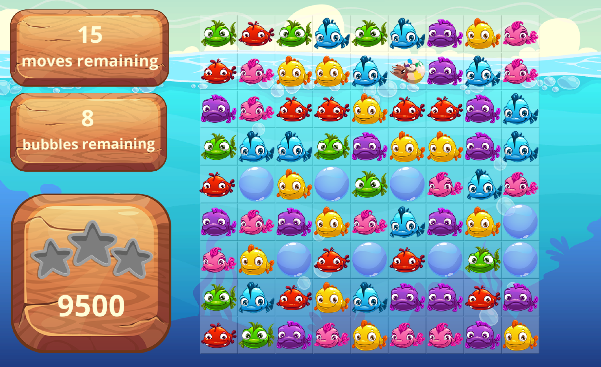
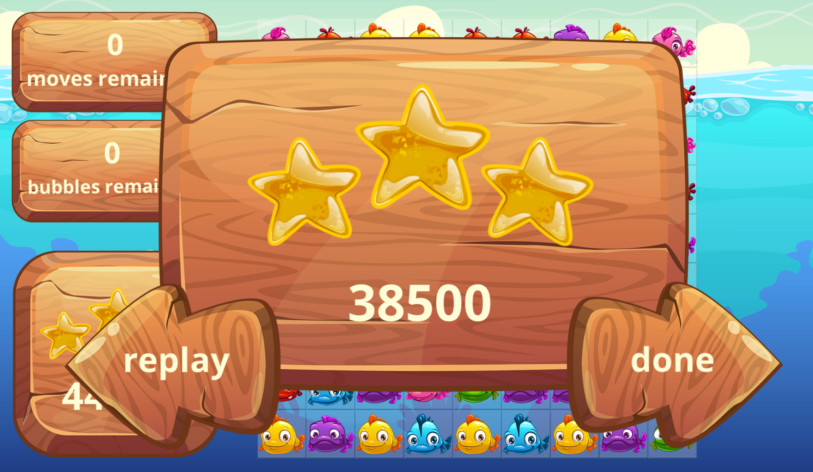

# Match3 Game in Unity

> Updated to Unity `6000.3.29f1` LTS

Match 3 games are simple puzzle games where the player pairs three or more identical items on a tiled game board.
Popular modern variations include Candy Crush and Bejeweled.
Unity is ideally suited to this kind of game design, and it's a great entry point for game development.

We cover topics like creating a grid-based game board, using inheritance to create different types of game pieces,
adding obstacles and new levels, detecting matches and clearing pieces, and implementing a user interface complete with a score screen.

Based on [Kelley Hecker's course](https://www.linkedin.com/learning/building-a-match-3-game-with-unity).

## Input

Uses Unity Input System with Active Input Handling set to **Input System Package (New)**.

Press a piece, drag onto an adjacent piece, then release to attempt a swap.
Tapping a piece or releasing outside the board cancels the gesture.
