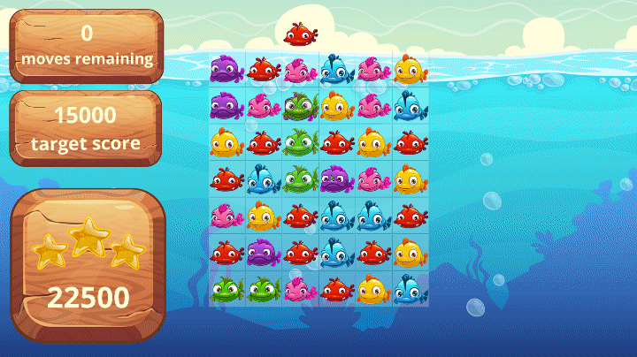

# Match3 Game in Unity

> Updated to Unity `6000.3.29f1` LTS

Match 3 games are simple puzzle games where the player pairs three or more identical items on a tiled game board.
Popular modern variations include Candy Crush and Bejeweled.
Unity is ideally suited to this kind of game design, and it's a great entry point for game development.

We cover topics like creating a grid-based game board, using inheritance to create different types of game pieces,
adding obstacles and new levels, detecting matches and clearing pieces, and implementing a user interface complete with a score screen.

Based on [Kelley Hecker's course](https://www.linkedin.com/learning/building-a-match-3-game-with-unity).

## Input

Uses Unity Input System with Active Input Handling set to **Input System Package (New)**.

Press a piece, drag onto an adjacent piece, then release to attempt a swap.
Tapping a piece or releasing outside the board cancels the gesture.

## Platform builds

Open **File > Build Profiles** and select the Android or iOS profile in
`Assets/BuildProfiles`. Both use the shared scene list: LevelSelect, Level01,
Level02, and Level03. The macOS platform uses the same scene list.

| Platform | Minimum OS | Graphics | Scripting backend |
| --- | --- | --- | --- |
| Android | Android 17 (API 37) | OpenGL ES 3 | IL2CPP (ARM64) |
| iOS | iOS 15.0 | Metal | IL2CPP |
| macOS | macOS 15.0 Sequoia | Metal (automatic) | IL2CPP |

Android explicitly targets API 37. Raising its minimum from API 25 to API 37
excludes Android 16 and earlier. The APK targets ARM64 devices. GLES2-only
devices are unsupported. GLES3 is the selected Android backend, without
requiring Vulkan or GLES 3.1/3.2.

Install Android Build Support (including SDK, NDK, and OpenJDK), iOS Build
Support, and Mac Build Support (IL2CPP) for Unity `6000.3.29f1` in Unity Hub.
Use the device SDK for iOS exports, then build and sign the generated Xcode
project with a current Xcode installation. The iOS deployment minimum is
separate from the SDK version supplied by Xcode.

Before release, install the Android APK on an Android 17 device with GLES3
support and check level selection, sprites, HUD, dragging to swap, and level
completion. Editor rendering and a successful APK build do not validate the
Android graphics driver. iOS exports also require device testing and signing.
